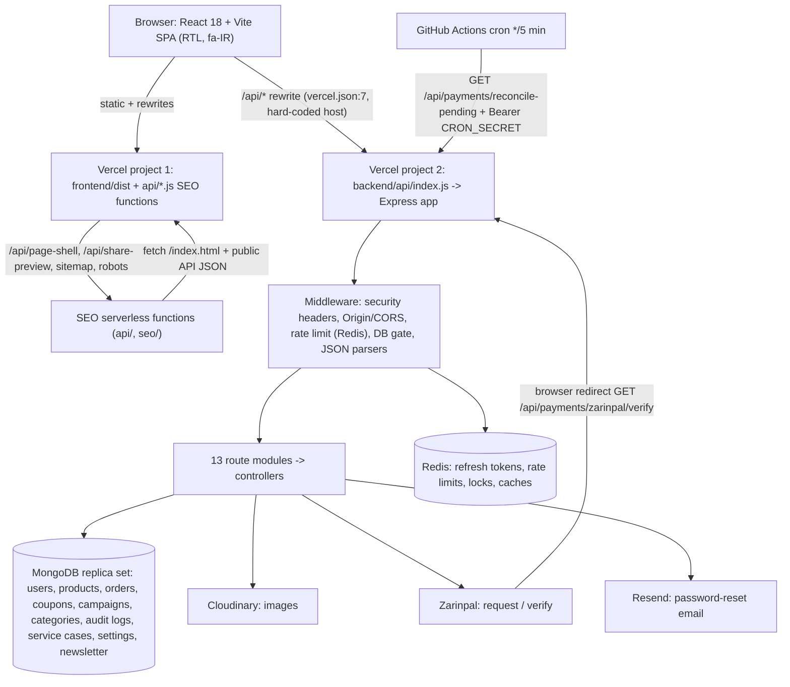

# 02 — Architecture review

Based on source code (routes, models, `vercel.json`, workflows), not on README claims.

## 1. System diagram

## 2. Modules
| Layer | Contents |
|---|---|
| Entry points | `backend/server.js` (long‑running listener; connects DB first), `backend/api/index.js` (Vercel handler), `backend/app.js` (shared Express app). Frontend `frontend/src/main.jsx` → `App.jsx` (lazy routes). `api/*.js` SEO functions. |
| Routes (13) | auth, products, categories, cart, coupons, payments, analytics, campaigns, shipping, newsletter, orders, admin, service‑cases. |
| Controllers | 13 files, ~4.7k lines; the biggest: `product.controller.js` (1141), `zarinpal.controller.js` (931), `auth.controller.js` (503). |
| Libs | `admin-permissions` (lock + last‑admin rules), `inventory-stock`, `coupons`, `payment-reconciliation`, `shipping`, `image-upload`, `persian-search`, `refresh-token`, `readiness`, `audit-log`, `redis`, `db`. |
| Models | user, product, order, coupon, campaign, category, store‑settings, service‑case, newsletter‑subscriber, audit‑log. |
| Frontend | pages (21), components (29, including 14 admin tabs), 5 Zustand stores, axios client with a single‑flight refresh coordinator, SEO utilities shared with the serverless functions via a relative import (`seo/server-utils.js` imports from `frontend/src/lib`). |
| Ops | `scripts/*.mjs` migrations and reconciler; three GitHub workflows. |

## 3. Key data flows
1. **Auth:** login sets HTTP‑only `accessToken` (15 min) and `refreshToken` (7 d) cookies, SameSite=Strict; refresh token stored in Redis under one key per user and rotated atomically. `protectRoute` verifies the JWT then reloads the user from MongoDB on every request (so permission/deactivation changes apply immediately).
2. **Authorization:** `adminRoute` resolves a permission from a central rules table keyed by mount path + method + route template; unknown routes fail closed; users whose `permissions` field is undefined ("legacy admins") pass every mapped route.
3. **Checkout:** server reads the user's cart → validates variants/stock → computes price, coupon, shipping server‑side → opens a MongoDB transaction that reserves stock and the coupon and creates a `pending` order → Zarinpal `request` → redirect. Callback `GET /payments/zarinpal/verify` (unauthenticated, ownership via stored authority) verifies with Zarinpal and finalizes idempotently via compare‑and‑set plus a unique authority index. A cron‑driven reconciler resolves uncertain/expired orders and releases stock.
4. **Catalogue SEO:** Vercel rewrites most public paths to `/api/page-shell` or `/api/share-preview`, which fetch the SPA `index.html` and public API JSON, then inject meta/JSON‑LD.

## 4. Strengths
- Money is integer Toman end to end; prices/discounts/shipping are server‑authoritative; atomic conditional stock updates; idempotent finalization; crash‑recovery phases; transaction requirement is explicit.
- Central, fail‑closed admin permission table; admin changes serialised by a fail‑closed Redis lock; audit log on writes.
- Defence in depth for browsers: SameSite=Strict, Origin + Fetch‑Metadata checks, exact CORS; no `dangerouslySetInnerHTML`; SEO HTML escapes all interpolations.
- Code‑split frontend (admin tabs and pages lazy), Intl‑based Jalali handling.
- Serverless awareness (connection reuse, pool limits, readiness probe).

## 5. Weaknesses
- **Two deployments glued by a hard‑coded rewrite** (`vercel.json:7` → a specific `*.vercel.app` backend); cookies/Origin checks, canonical URLs, and rate‑limit IP depend on this topology; changing brand/domain needs edits in several places.
- **Reliability depends on external schedulers and Redis**: a GitHub Actions cron (best‑effort, minimum 5 min, can be delayed or disabled for inactivity) is the only trigger of payment recovery; correctness defects in the reconciler (BIZ‑1/2/3) mean it currently cannot reliably free stranded orders.
- **Global middleware ordering**: DB gate runs before auth and body parsing; 10 MB parser before auth (SEC‑4).
- **Permission model coupled by string tables**: rules table duplicates the route files; frontend keeps a third copy (tab→permission); legacy semantics scattered (AUTH‑2/13).
- **Large controllers** mix validation, business rules and persistence (no service layer, no schema validation library); product controller 1.1k lines.
- **Frontend RTL via CSS inversion hack, dark theme via attribute‑selector patch layer** (FE‑3, FE‑18), whole‑store Zustand subscriptions (FE‑6), refresh unmounts app (FE‑1).
- **Brand and category knowledge hard‑coded** across ~30 files (see FE section D in report 04).
- **Duplicated manifests** (root and backend `package.json` both list backend deps; backend has no lockfile), hand‑maintained `node --check` build scripts.
- No Dockerfile/compose/IaC, no structured logging, no metrics/alerts (report 06).
